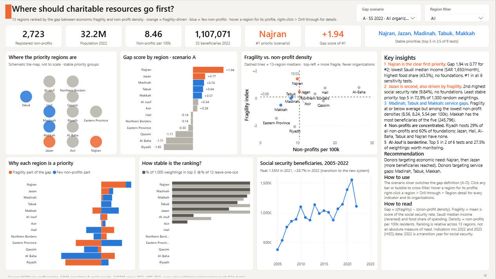

# Regional Priorities for Charitable Resources: Power BI Project

This is the Power BI version of `analysis.ipynb`. It answers one question: **where should donors and charities prioritize resources across Saudi Arabia's 13 regions?**

Regions are ranked by the gap between **economic fragility** and **non-profit density**. Every number in the report was checked against the notebook outputs: 534 values, all pass (see `04_docs/10_Validation_Report.md`).

## Open it

1. Open `03_powerbi/RegionalPriorities.pbip` in Power BI Desktop (June 2026 or later; PBIP/TMDL/PBIR format).
2. If a yellow bar says *Some of the tables have incomplete or no data*, click **Refresh now**.

The project is portable. Each query reads `02_data/*.csv` and falls back to a copy of the same data embedded in the model when that folder isn't found, so it refreshes on any computer without editing anything.

## The report: one dashboard



| Page | What it is |
|---|---|
| **Regional Priorities Dashboard** | The single dashboard: 7 KPIs, tile map, gap ranking, fragility vs density (quadrants), gap decomposition, robustness, social security trend, insights and recommendation. A scenario slicer (A-D) and a region slicer. |
| Region tooltip *(hidden)* | Appears when you hover a region: its rank, gap source and 9 indicators. |
| Region detail *(hidden)* | Drill-through: right-click a region, then *Drill through > Region detail*. It shows every indicator with its rank, the trend, the sensitivity-test ranks and the region's organizations. |

## Folder structure

```
powerbi_project/
├── README.md                     this file
├── 01_scripts/                   everything that builds and checks the project
│   ├── build_model_data.py       raw data → clean star schema (re-runs the notebook logic, 36 assertions)
│   ├── build_semantic_model.py   writes the TMDL model (tables, relationships, 111 DAX measures, M with embedded fallback) + DAX/M docs
│   ├── build_report.py           writes the PBIR report (dashboard + tooltip + drill-through pages, theme)
│   ├── pbi_dax.ps1               refreshes / queries the model open in Power BI Desktop (XMLA)
│   ├── validation_queries.dax    DAX queries used for validation
│   └── compare_results.py        compares DAX results with the notebook → validation report
├── 02_data/                      clean CSVs loaded by Power BI (+ the same tables in one Excel workbook)
├── 03_powerbi/
│   ├── RegionalPriorities.pbip   ← open this
│   ├── RegionalPriorities.SemanticModel/   model (TMDL)
│   ├── RegionalPriorities.Report/          report (PBIR)
│   └── theme/RegionalPriorities_Theme.json
└── 04_docs/
    ├── 01_Project_Analysis.md            notebook review: data, cleaning, analyses, findings
    ├── 02_Data_Model.md                  star schema, relationships, design choices
    ├── 03_DAX_Measures.md                every measure with its code (generated)
    ├── 04_Power_Query_M.md               every query (generated)
    ├── 05_Dashboard_Design.md            layout, visual by visual, interactivity
    ├── 06_Build_Guide.md                 step-by-step build (automated and manual)
    ├── 07_KPI_Dictionary.md              KPI definitions, formulas and values
    ├── 08_Business_Insights.md           findings, recommendations, caveats
    ├── 09_Python_to_PowerBI_Mapping.md   what moved to M, DAX or visuals, and what stayed in Python
    ├── 10_Validation_Report.md           DAX vs notebook comparison (generated)
    └── validation/                       expected values and raw DAX outputs
```

## Rebuild from scratch

```powershell
.venv\Scripts\python powerbi_project\01_scripts\build_model_data.py      # data (fails if the notebook logic no longer reproduces)
.venv\Scripts\python powerbi_project\01_scripts\build_semantic_model.py  # model + DAX/M docs
.venv\Scripts\python powerbi_project\01_scripts\build_report.py          # report
# open the .pbip, refresh, then validate:
powershell -File powerbi_project\01_scripts\pbi_dax.ps1 -QueryFile powerbi_project\01_scripts\validation_queries.dax -OutDir powerbi_project\04_docs\validation\dax_results
.venv\Scripts\python powerbi_project\01_scripts\compare_results.py
```

`build_semantic_model.py` and `build_report.py` overwrite the model and report folders. If you edit the report in Power BI Desktop, save it there and stop using the generators, or port your changes into them.
